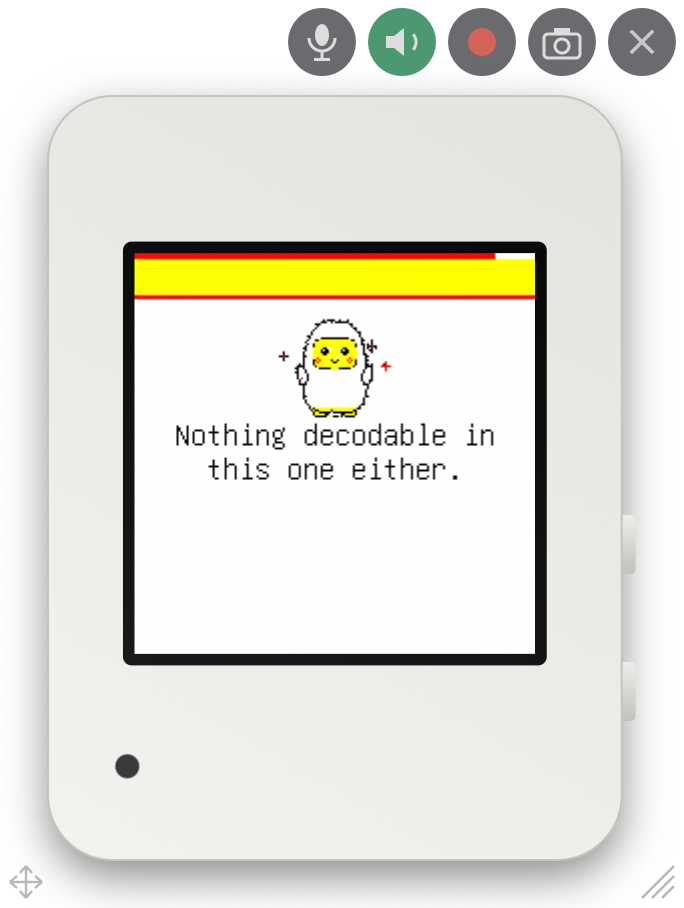

# espmirror

The screen of your ESP32 board on your desktop, live, drawn as the device it
is: the body, the buttons, the LED. Click the buttons, hear what it plays,
talk into its speaker, record a video, take a screenshot at the real size.
An ESP-IDF component on the board, one Python window on the computer, plain
TCP between them.

<p align="center">
  
  &nbsp;&nbsp;&nbsp;
  
</p>

Why: a board on the desk is small, far from the screen you are reading logs
on, and impossible to show to someone on a call. With the mirror the device
is a window: you see what it shows, press what it has, and the recording
goes into the bug report.

## What it does

- **Frames** of changed rectangles, run-length coded, 25 a second at most;
  an idle board sends one empty frame a second. A 240 × 240 user interface
  costs about 20 KB/s while it animates and nothing while it does not.
- **Keys**: the viewer's drawn buttons and the keyboard press the board's
  buttons, tapped or held. The firmware gets a callback.
- **LED**: the board reports it, the viewer lights it on the body.
- **Audio**: the viewer hears the board's speaker (clicks, cues, replies) or
  its microphone, and can talk into the board's speaker. Off at build time
  if you don't want it.
- **The viewer** is one Python file for macOS: no title bar, the device and
  its buttons, real size on any display (it reads the display's millimetres),
  record to mp4, screenshot to png, float on top, Dock icon with the live
  screen.
- **Device profiles**: the viewer knows the Waveshare 2.16 and 1.75C AMOLED
  boards, the Waveshare 1.54G e-paper and the XOrigin AIPI Lite. Another
  device is a line of millimetres (docs/devices.md).

## Minimum requirements

| | |
|---|---|
| Chip | any ESP32 with Wi-Fi (ESP32, S2, S3, C3, C6, P4 with a Wi-Fi coprocessor) |
| ESP-IDF | 5.1 or later; LVGL hook for LVGL 9 |
| RAM | the screen copy `width × height × 2` bytes, the message buffer (32 KB by default, 8 KB at least), 1 KB input, 16 KB for audio when on, 4 KB of task stack |
| PSRAM | not required; used when present (`CONFIG_ESPMIRROR_PREFER_PSRAM`) |
| Computer | macOS with Python 3.11+ (the viewer is AppKit); `ffmpeg` for recordings |

RAM in practice:

| Screen | Copy | With defaults (32 KB messages, audio) | Fits without PSRAM? |
|---|---|---|---|
| 128 × 128 | 32 KB | 85 KB | yes |
| 240 × 240 | 113 KB | 166 KB | on an ESP32-S3 with Wi-Fi, usually; with 8 KB messages and no audio, 123 KB |
| 320 × 240 | 150 KB | 203 KB | PSRAM |
| 466 × 466 | 424 KB | 477 KB | PSRAM |

The board's CPU cost is the run-length coding of what changed: under a
millisecond for a text update, a few milliseconds for a full 240 × 240
repaint.

## Add it to a project

```sh
idf.py add-dependency "menemy/espmirror"
```

or in `main/idf_component.yml`:

```yaml
dependencies:
  menemy/espmirror: "^0.1"
```

Then, once the network is up:

```c
#include "espmirror.h"

static void on_key(int key, bool down, void *user) {
    /* 1, 2, 3 as the viewer draws them; hand it to your input path */
}

const espmirror_config_t cfg = {
    .name = "Waveshare 1.54G",   /* picks the device's look in the viewer */
    .width = 200, .height = 200, .ppi = 184,
    .on_key = on_key,
};
ESP_ERROR_CHECK(espmirror_start(&cfg));
```

**With LVGL 9** (the usual case), one more line with the LVGL lock held:

```c
#include "espmirror_lvgl.h"
espmirror_attach_lvgl(NULL);          /* the default display; every flush passes the mirror */
```

**Without LVGL**, draw into the copy yourself:

```c
uint16_t *fb = espmirror_frame_begin();      /* width × height RGB565, locked */
/* ... */
espmirror_frame_end(x, y, w, h);             /* what changed */
```

or `espmirror_draw(x, y, w, h, pixels, stride)` for a ready rectangle (an
e-paper frame, a camera image).

**Audio, LED, state**: `espmirror_audio_capture()` with what the microphone
gives, `espmirror_audio_playback()` with what the speaker gets (both PCM16 at
16 kHz), `espmirror_set_led()`, `espmirror_set_screen_state()` when the
panel dims or sleeps. The viewer's own microphone comes back through
`on_talk` and `on_talk_audio` in the config.

## The viewer

```sh
python3 -m venv .venv && .venv/bin/pip install -r tools/requirements.txt
.venv/bin/python tools/mirror_window.py 192.168.1.42
```

Drag by the handle at the bottom left, resize by the one at the bottom
right. The View menu: Screenshot (Cmd S), Record (Cmd R), Sound (Cmd L),
Mic (Cmd Shift L), Talk (Cmd K), Bigger, Smaller, Actual size (Cmd 0),
Float on Top (Cmd T). The keys 1, 2, 3 press the device's buttons.

`--sound` starts with the board's sound on, `--on-top` floating,
`--stats` prints frame statistics with no window, `--png out.png` saves the
screen once it is still.

## Examples

- `examples/basic`: no display at all; the board draws a clock, a bouncing
  square and the keys you press into the mirror. Any devkit.
- `examples/lvgl`: LVGL 9 with no panel behind it; the mirror is the
  display. The viewer's keys move a slider.

```sh
cd examples/basic
idf.py set-target esp32s3
idf.py menuconfig          # Example Connection Configuration: your Wi-Fi
idf.py flash monitor       # then run the viewer with the IP it prints
```

## Your device

The viewer draws a board it knows; one it does not gets a plain frame. A
profile is one line of millimetres from the maker's drawing and a
screenshot: see [CONTRIBUTING.md](CONTRIBUTING.md), or open an
[issue](https://github.com/menemy/espmirror/issues/new?template=device.yml)
with the drawing and somebody with the board will add it.

## How it works

The board keeps a copy of the screen (RGB565) and a list of dirty
rectangles. Every 40 ms the mirror task codes the dirty rectangles in the
shortest of raw, row runs and column runs, and sends one message. The viewer
applies them to its own copy and repaints the glass. Nothing is sent while
nothing changes. One viewer at a time; a new one takes over, the old one is
told.

The LVGL hook listens to `LV_EVENT_FLUSH_START` and copies the flushed area
out of the active draw buffer before the display driver swaps bytes for the
panel, so it works with any driver, partial or full render mode, native or
byte-swapped RGB565, and never touches the buffer.

The wire is in [docs/protocol.md](docs/protocol.md). Device profiles in
[docs/devices.md](docs/devices.md).

## Limits

- The viewer is macOS only (AppKit). The protocol is trivial; a viewer for
  another platform is a day's work.
- Audio from the board is a debugging feature: anything the microphone
  hears goes to whoever runs the viewer on the local network. Leave
  `CONFIG_ESPMIRROR_AUDIO` off in a production image, or the component out.
- No authentication: the mirror is for a board on your bench and your
  network.
- RGB565 only.

## License

Apache-2.0. The device drawings in the viewer follow the makers' published
dimensions; the device names are theirs.
