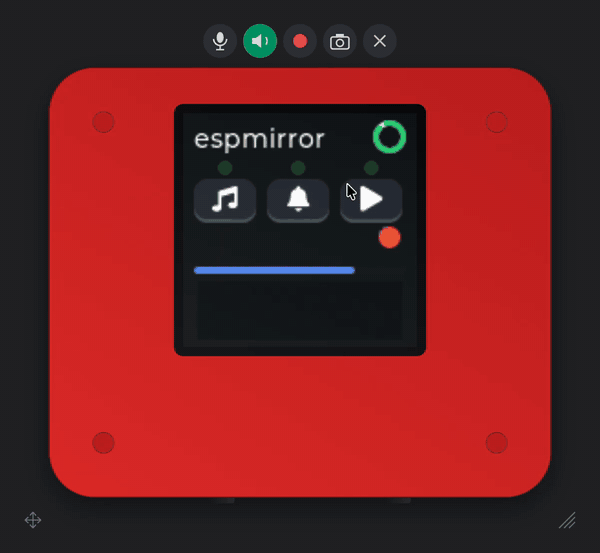

# espmirror

The screen of your ESP32 board on your desktop, live, drawn as the device it
is: the body, the buttons, the LED. Click the buttons, hear what it plays,
talk into its speaker, record a video, take a screenshot at the real size.
An ESP-IDF component on the board, one Python window on the computer: a USB
cable by default, a network over the same cable or Wi-Fi as options.

<p align="center">
  
</p>

That is `examples/lvgl` on an XOrigin AIPI Lite. The viewer's keyboard
presses the device's keys, the mouse presses the buttons on screen, the
sounds the board synthesises play on the Mac (and on the board's speaker),
the board's microphone goes to the spectrogram and to the Mac, and the LED
on the drawn body follows the board's.

Why: a board on the desk is small, far from the screen you are reading logs
on, and impossible to show to someone on a call. With the mirror the device
is a window: you see what it shows, press what it has, and the recording
goes into the bug report.

## Try it without a board

```sh
python3 -m venv .venv && .venv/bin/pip install -r tools/requirements.txt
.venv/bin/python tools/fake_board.py --board waveshare-s3-216 &
.venv/bin/python tools/espmirror.py 127.0.0.1
```

`fake_board.py` speaks the protocol on 127.0.0.1 with a test pattern, and the
viewer draws it as the Waveshare 2.16; `fake_board.py --list` names the other
presets.

## What it does

- **Frames** of changed rectangles, run-length coded, 25 a second at most;
  an idle board sends one empty 8-byte frame a second. A 240 × 240 user
  interface costs about 20 KB/s while it animates and next to nothing while
  it does not.
- **Keys and touch**: the viewer's drawn buttons and the keyboard press the
  board's buttons, tapped or held; the mouse on the glass is a touch. The
  firmware gets a callback for each.
- **Typing**: while a text field is open on the board, the computer's
  keyboard types into it, paste included. The LVGL hook finds the focused
  textarea by itself.
- **LED**: the board reports it, the viewer lights it on the body.
- **Audio**: the viewer hears the board's speaker (clicks, cues, replies) or
  its microphone, and can talk into the board's speaker. Off at build time
  if you don't want it.
- **The viewer** is PySide6, with offscreen CI configured for Windows, Linux
  and macOS; physical boards have been tested on macOS: no title bar, the device and its buttons, real size on any
  display (it reads the display's millimetres), record to mp4, screenshot to
  png, float on top, Dock icon with the live screen.
- **Device profiles**: the viewer knows the Waveshare 2.16 and 1.75C AMOLED
  boards, the 1.54G e-paper, the 3.49 bar LCD, the P4 3.5 LCD and the
  XOrigin AIPI Lite, each drawn
  from an image of the device (AI-generated today; a photograph of yours
  drops in). Another device is a line of
  millimetres and a picture (docs/devices.md).

## Minimum requirements

| | |
|---|---|
| Chip | an ESP32 with native USB (Serial/JTAG, or USB OTG for the USB network; the S3 has both); any other ESP32 over TCP |
| ESP-IDF | 5.1 or later; the LVGL hook needs LVGL 9.5 or later (from the registry: ESP-IDF 5.4 or later, whose component manager reads LVGL's manifest) |
| RAM | the screen copy `width × height × 2` bytes, the message buffer (32 KB by default, 8 KB at least), 1 KB input, 16 KB for audio when on, 4 KB of task stack |
| PSRAM | not required; used when present (`CONFIG_ESPMIRROR_PREFER_PSRAM`) |
| Computer | Python 3.11+ and PySide6 on macOS, Linux or Windows; `ffmpeg` for recordings; platform coverage below |

Version 1 baseline RAM, excluding the v2 USB queue and optional delta reference:

| Screen | Copy | With defaults (32 KB messages, audio) | Fits without PSRAM? |
|---|---|---|---|
| 128 × 128 | 32 KB | 85 KB | yes |
| 240 × 240 | 113 KB | 166 KB | version 1 on an ESP32-S3 with Wi-Fi, usually (with 8 KB messages and no audio, 123 KB); version 2 with Wi-Fi needs PSRAM, below |
| 320 × 240 | 150 KB | 203 KB | PSRAM |
| 466 × 466 | 424 KB | 477 KB | PSRAM |

Measured with version 2 on a XIAO ESP32S3 (`examples/virtual`, 240 × 240, USB
and TCP, no audio): `espmirror_start()` takes 207 KB of internal RAM without
PSRAM, too much for Wi-Fi to start as well, and 55 KB with PSRAM.

Encoder cost depends on dirty area, selected codings, PSRAM and transport.
Host tests do not establish target frame rates.

## Add it to a project

```sh
idf.py add-dependency "menemy/espmirror"
```

or in `main/idf_component.yml`:

```yaml
dependencies:
  menemy/espmirror: "^0.2"
```

The mirror goes over the USB cable when the console is on USB Serial/JTAG.
The console is on the UART by default, and `espmirror_start()` then returns
`ESP_ERR_NOT_SUPPORTED` unless TCP or ESP-Iris is on. In `sdkconfig.defaults`:

```
CONFIG_ESP_CONSOLE_USB_SERIAL_JTAG=y
```

Then start the component (Wi-Fi is not required for USB):

```c
#include "espmirror.h"

static void on_key(int key, bool down, void *user) {
    /* 1, 2, 3 as the viewer draws them; hand it to your input path */
}

const espmirror_config_t cfg = {
    .name = "Waveshare 1.54G",   /* picks the device's look in the viewer */
    .width = 200, .height = 200, .ppi = 184,
    .on_key = on_key,
};
ESP_ERROR_CHECK(espmirror_start(&cfg));
```

**With LVGL 9** (the usual case), one more line with the LVGL lock held:

```c
#include "espmirror_lvgl.h"
espmirror_attach_lvgl(NULL);          /* the default display; every flush passes the mirror */
```

**Without LVGL**, draw into the copy yourself:

```c
uint16_t *fb = espmirror_frame_begin();      /* width × height RGB565, locked */
/* ... */
espmirror_frame_end(x, y, w, h);             /* what changed */
```

or `espmirror_draw(x, y, w, h, pixels, stride)` for a ready rectangle (an
e-paper frame, a camera image).

**Audio, LED, state**: `espmirror_audio_capture()` with what the microphone
gives, `espmirror_audio_playback()` with what the speaker gets (both PCM16 at
16 kHz), `espmirror_set_led()`, `espmirror_set_screen_state()` when the
panel dims or sleeps. The viewer's own microphone comes back through
`on_talk` and `on_talk_audio` in the config. With `audio_route` set, pass the samples
through `espmirror_audio_output()` just before the codec and
`espmirror_audio_input()` just after it instead: the viewer can then hear the
speaker alone and lend the board its microphone, alongside the board's or in
its place. Keep reading the microphone while `espmirror_audio_input_wanted()`.

## Transports

USB serial, USB network, TCP and ESP-Iris; a board can have the cable and a
network at once.

**USB serial** (the default). Select `CONFIG_ESP_CONSOLE_USB_SERIAL_JTAG=y`
(or console NONE) and `CONFIG_ESPMIRROR_USB=y`. UART and USB OTG CDC consoles
are not supported. The default `CONFIG_ESPMIRROR_USB_AUTO=y` installs the
driver and reads complete `mirror` / `>mirror` commands. It does not interpret
other console input. If your app installs the driver and reads the console,
set `external_console` in the config and call `espmirror_serial_session()`
after reading that line. Do not read the console concurrently with the
session. ESP_LOG records remain visible between CRC-protected frames.
`--log FILE` saves the host log.

**USB network** (`CONFIG_ESPMIRROR_USB_NETWORK=y`, chips with USB OTG such as
the S3). The port becomes a TinyUSB device with a serial port and a network on
one cable, both carrying the mirror. The viewer finds the board by itself on
the serial port; the network takes `python3 tools/espmirror.py 192.168.7.1` or
any other TCP client, at a similar rate. The board is `192.168.7.1`
(`CONFIG_ESPMIRROR_USB_NETWORK_SUBNET` picks the 7; two boards on one computer
need different values) and hands the computer an address with no route: a Mac
kept its default route on its own network. ESP-IDF's DHCP server always names
a DNS server, here the board, which answers no DNS queries; on Windows 11 that
was reported to break name resolution while such a device is plugged in
([esp-idf#19190](https://github.com/espressif/esp-idf/issues/19190)).
Microsoft lists its CDC-NCM driver for Windows 11 and Windows Server 2022, not
Windows 10. Tested on macOS with ESP-IDF 6.0.1 only.

Add `espressif/esp_tinyusb` 2.4.0 or later to your app with
`CONFIG_TINYUSB_CDC_ENABLED=y`, `CONFIG_TINYUSB_NET_MODE_NCM=y`, a product
string containing `espmirror`, which the viewer looks for, and an empty serial
string, which esp_tinyusb turns into the MAC; `examples/virtual/sdkconfig.usbnet`
has the full list. It turns on TCP, so the port also listens on Wi-Fi if the
app joins a network. USB Serial/JTAG is off the port while TinyUSB runs: flash
with BOOT held, and read the boot log on the UART.

**TCP** (`CONFIG_ESPMIRROR_TCP=y`, on port 7331 with mDNS) binds to every
address, so it listens on each network the app brings up, such as Wi-Fi or the
USB network. The app starts Wi-Fi itself. The mirror keeps a hostname the app
has already set and names the host `espmirror` otherwise. `mdns_init()` has no
lock, so an app with its own mDNS starts it before `espmirror_start()`, not in
another task at the same time. Existing configurations with the
earlier name, `CONFIG_ESPMIRROR_WIFI`, keep TCP through `sdkconfig.rename`.
The port has **no authentication**. Anyone who can reach it can
see the screen, press keys, listen and talk. Leave TCP off in deployed images
unless the network and these capabilities are intentionally trusted.

**ESP-Iris** (`CONFIG_ESPMIRROR_IRIS=y`). The application supplies and starts
`esp_iris`, which owns its USB transport. Start espmirror before Iris; it
registers the screenshot framebuffer, pointer input, keys and board metadata.
The viewer carries espmirror's encoded dirty rectangles over Iris IMAGE, with
chunk ACKs and reference recovery after loss. Older firmware uses raw SCREEN.
The viewer uses a running ESP-Iris Gateway:

```sh
python3 tools/espmirror.py iris:DEVICE_ID --iris-gateway http://127.0.0.1:PORT
python3 tools/espmirror.py --list --iris --iris-gateway http://127.0.0.1:PORT
```

Replace `DEVICE_ID` with the Gateway's 32-digit device ID and `PORT` with
its HTTP port. `ESPMIRROR_IRIS_GATEWAY` also sets the URL; the fallback is
`http://127.0.0.1:8443`. The viewer does not start or restart the Gateway.
`--iris` opts into discovery through its device list. Iris supports screen,
touch and keys here; audio, LED and typing are available through serial/TCP.
The Iris path needs the `websockets` package in `tools/requirements.txt`.
Its synchronous client fits the viewer's existing worker threads.
[`examples/mosaico`](examples/mosaico) builds a mirror-only ESP32-S31
application with the ESP-Mosaico Vibe Mode 0.2 recovery contract.
Its optional panel build drives CO5300, CST9220, FN and BOOT.

Delta and QOI are off by default (`CONFIG_ESPMIRROR_DELTA`,
`CONFIG_ESPMIRROR_QOI`). Delta requires another width*height*2 byte reference.
The USB input queue stores 2,112 bytes without audio or 20,608 bytes with
audio, plus FreeRTOS queue overhead. Measure actual allocation and frame
timing on your board.

## The viewer

```sh
python3 -m venv .venv && .venv/bin/pip install -r tools/requirements.txt
.venv/bin/python tools/espmirror.py
# or: python tools/espmirror.py COM12
# or: python tools/espmirror.py /dev/ttyACM0
# explicit network target: python tools/espmirror.py 192.168.1.42
```

On Windows, from PowerShell:

```powershell
py -3 -m venv .venv
.\.venv\Scripts\python.exe -m pip install -r tools/requirements.txt
.\.venv\Scripts\python.exe tools/espmirror.py
# or: .\.venv\Scripts\python.exe tools/espmirror.py COM12
```

On Linux, USB Serial/JTAG and TinyUSB CDC ports normally appear as
`/dev/ttyACM*`. Check access with `ls -l /dev/ttyACM0`. On Debian and Ubuntu,
add your user to the device's `dialout` group with
`sudo usermod -aG dialout "$USER"`, then log out and back in. Some distributions
use `uucp` instead. A desktop session may grant access through a udev `uaccess`
rule; containers and remote sessions may not receive that ACL. If your system
needs a custom rule, scope it to the board's VID, PID and, for multiple boards,
serial number. USB Serial/JTAG is `303a:1001`; use `udevadm info` to inspect a
TinyUSB board's IDs. Keep the normal group permissions; do not run the viewer
as root. Close serial monitors before connecting. Discovery only reads port
descriptors; the selected board is opened for the mirror handshake.

On Windows, pyserial opens `COMn` ports, including numbers above 9. USB
Serial/JTAG is selected by VID/PID. Because Windows port enumeration does not
provide the product/interface strings used on Linux/macOS, Espressif TinyUSB
PIDs `4000` through `40ff` are candidates; a candidate must answer the mirror
handshake. USB network driver support and the DNS caveat are in Transports
above. This serial path does not require the USB network interface.
See [pyserial port enumeration](https://pyserial.readthedocs.io/en/latest/tools.html#serial.tools.list_ports)
for the platform-dependent descriptor fields.

Drag by the body or the arrows button at the top, resize by any corner.
The View menu: Screenshot (Cmd S), Record (Cmd R), Sound (Cmd L),
Mic (Cmd Shift L), Talk (Cmd K), Bigger, Smaller, Actual size (Cmd 0),
Float on Top (Cmd T). Use Ctrl on Windows/Linux. The keys 1 through 4 press
board buttons, with arrows/Enter/Escape for navigation; while a text field is
open on the board under the mouse, the keys type into it instead. Several boards share a
window. Click a board before using the shared audio toolbar. The listen button
selects its speaker; Ctrl+Shift+L selects its microphone. Talk toggles your
microphone; the board may refuse it. OS microphone permission is required.
QtMultimedia handles audio without sounddevice. Talk requests microphone
permission through Qt; denied permission is reported in the window. Device-native audio formats are
converted to/from mono PCM16 at 16 kHz with bounded queues.

Two-finger scrolling becomes a touch gesture with a pointer disc. Show touches
controls the fading touch marks. Screenshots and recordings contain the devices
without the toolbar. `ffmpeg` must be on PATH for mp4 recording. Photos default
to `tools/devices/`; `--devices DIR` overrides them. Discovery is USB-only and
passive. `--wifi` adds mDNS; an explicit address always selects TCP.

`--sound` starts with the board's sound on, `--on-top` floating,
`--stats` prints frame statistics with no window for `--seconds N` (5 by
default); with it, `--png out.png` saves the screen once it is still.
`--scale K` starts the window at K times the real size.

By default, captures use the operating system's Desktop folder, including redirected
Windows desktops and Linux XDG directories, or the home directory if that
folder is absent. `ffmpeg -version` checks that the command-line encoder is
available; its build must include `libx264`. Qt's multimedia libraries alone
do not provide the `ffmpeg` command used for recordings. On Windows, allow
desktop applications to access the microphone in the system privacy settings
before using Talk ([Microsoft's microphone permissions guide](https://support.microsoft.com/en-us/windows/privacy/turn-on-app-permissions-for-your-microphone-in-windows)).
The Desktop folder is resolved through [Qt standard paths](https://doc.qt.io/qt-6/qstandardpaths.html).

### Platform checks

The `viewer` CI job is configured for Python 3.12 on macOS, Ubuntu and Windows,
with `QT_QPA_PLATFORM=offscreen`. It runs protocol/decoder tests, mocked USB
descriptor discovery and audio-device tests, profile rendering at scale
factors 1, 1.5 and 2, and a TCP fake-board test with key input and PNG capture.
The Linux job installs Qt's system libraries, `ffmpeg` and `ffprobe`. When those
commands are on PATH, the suite also encodes an MP4 and checks its H.264 stream.
C sanitizer harnesses and the serial PTY test run only on POSIX;
the PTY uses real pyserial data I/O with modem-line updates stubbed because
PTYs have no DTR/RTS lines.

These checks do not verify real USB enumeration, Windows COM control-line
behaviour, physical audio playback/capture, microphone permissions, USB NCM
networking, or interaction with a desktop window manager. Windows hardware
has not been tested. Offscreen scale-factor tests do not establish physical
screen size or behaviour across monitors with different DPI settings.

On 2026-11-09, all 65 host tests passed in a Debian 13 aarch64 container with
Python 3.12.16, PySide6 6.12.0, pyserial 3.5 and ffmpeg 7.1.5. That run included
the offscreen TCP and serial PTY fake-board tests, PNG capture and MP4 encoding.
No USB devices or physical audio devices were passed into the container.

### Settings

Open **Settings…** from the right-click menu, or press Cmd+, (Ctrl+,
on Windows/Linux). On macOS, Qt places Settings in the application menu.
`python tools/espmirror.py --settings` opens the same dialog
without connecting to a board.

- **Window:** default size (25 to 800 percent), Float on Top, Show touches,
  remember window position, and listen to the first board's speaker at startup.
  Changing the default size applies it to the current window too. Resizing by
  a corner or Bigger/Smaller changes only the current window's size.
- **Files:** separate folders for screenshots and recordings, and an optional
  console log file. Empty capture folders use Desktop, or the home folder if
  Desktop is unavailable. Choose existing folders. The log is appended starting
  at the next launch; an empty log field disables it. If writing fails, a terminal
  warning reports that file logging is disabled for this run; the connection and
  console output continue.
- **Connections:** discover USB boards (on by default), discover mDNS network
  boards (off by default), and explicit addresses or serial ports, one per line.
  These choices apply at the next launch. An identical target is opened once;
  discovery prefers USB when a board advertises the same MAC over mDNS.

Save persists preferences using Qt's QSettings (`espmirror` / `mirror`). Cancel
leaves them unchanged. Window appearance and capture folders apply immediately;
startup sound, connections and logging apply at the next launch. Float on Top
and Show touches in View are also remembered. A remembered position on a
disconnected display is moved back onto the primary display.

Explicit command-line options override saved startup preferences for that run.
Settings shows saved defaults; saving unrelated fields preserves CLI overrides
in the current window. Changing default size or Float on Top explicitly also
updates the current window.
`--no-sound`, `--no-on-top`, `--no-wifi` and `--no-usb` disable their saved
counterparts; `--log ''` disables the saved log. Positional targets replace
both discovery and the saved target list. Headless `--list`, `--stats` and
`--png` use command-line options and built-in defaults, ignoring GUI preferences.

## Examples

- [`examples/virtual`](examples/virtual): bare ESP32-S3, USB only by default,
  LVGL animations, swipe pages and a list. No panel, audio hardware or Wi-Fi
  setup. BOOT and the viewer key count presses.
- `examples/basic`: no display at all; the board draws a counter, a bouncing
  square, the keys you press and where you touch into the mirror. Any devkit.
- `examples/lvgl`: the showcase. Animations, on-screen buttons the viewer's
  mouse presses, LEDs for the keys, three small sounds synthesised on the
  board, a spectrogram, the board's LED. On a board the example knows
  (`menuconfig` → espmirror example → The board) it drives the board's own
  panel, speaker, microphone and buttons too. Board implementations include
  XOrigin AIPI Lite, Waveshare AMOLED 2.16 and 1.75C, LCD 3.49 V2, e-Paper
  1.54G, and P4 LCD 3.5. See its [README](examples/lvgl/README.md) for
  capabilities, build overlays and hardware validation status. On a generic devkit the mirror
  supplies the display and audio output.
- [`examples/mosaico`](examples/mosaico): ESP32-S31 with ESP-Iris, a
  mirror-only default and an optional physical panel/touch/key build. Requires
  the matching preview toolchain and Vibe Mode partition layout.

```sh
cd examples/basic
idf.py set-target esp32s3
idf.py menuconfig          # Example Connection Configuration: your Wi-Fi
idf.py flash monitor       # then run the viewer with the IP it prints
```

`menuconfig` also picks the board, and the name the board gives the viewer
and the screen size for a devkit; name it after a device the viewer knows and
it is drawn as that device.

## Your device

The viewer draws a board it knows; one it does not gets a plain frame. A
profile is one line of millimetres from the maker's drawing and a
screenshot: see [CONTRIBUTING.md](CONTRIBUTING.md), or open an
[issue](https://github.com/menemy/espmirror/issues/new?template=device.yml)
with the drawing and somebody with the board will add it.

## How it works

The board keeps a copy of the screen (RGB565) and a list of dirty
rectangles. Every 40 ms the mirror task codes the dirty rectangles in the
shortest of raw, row runs and column runs, and sends one message. The viewer
applies them to its own copy and repaints the glass. While nothing changes,
one empty frame a second. One viewer at a time; a new one takes over, the
old one is told.

The LVGL hook listens to `LV_EVENT_FLUSH_START` and copies the flushed area
out of the active draw buffer before the display driver swaps bytes for the
panel, so it works with any driver that renders RGB565, in partial, direct
or full render mode, native or byte-swapped, and never touches the buffer
(a display offset set with `lv_display_set_offset` is not taken out).

The wire is in [docs/protocol.md](docs/protocol.md). Device profiles in
[docs/devices.md](docs/devices.md).

## Limits

- Audio from the board is a debugging feature: anything the microphone
  hears goes to whoever runs the viewer on the local network. Leave
  `CONFIG_ESPMIRROR_AUDIO` off in a production image, or the component out.
- No authentication: the mirror is for a board on your bench and your
  network.
- RGB565 only.

## License

Apache-2.0. The device images in the viewer are AI-generated, sized to the
published dimensions; the device names and designs belong to their makers.
